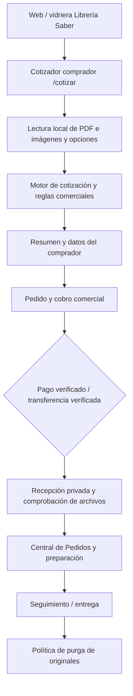

# Arquitectura y operación — Librería Saber

**Referencia:** 14/11/2026. Esta es una guía de orientación al código real, no un listado exhaustivo de endpoints o secretos. Verificar releases antes de intervenir.

## 1. Vista de conjunto

**Importante:** el orden de cobro, recepción y creación de pedidos tiene variantes por medio de pago y transporte de archivo. El diagrama resume responsabilidades, **no reemplaza la lectura de los contratos de código**.

## 2. Componentes identificados en GitHub

| Función | Fuente relevante |
| --- | --- |
| Entrada al cotizador comprador comercial | `integraciones/autocotizador/recepcion/pagina-cotizar-live.mjs` |
| Adaptador de opciones y carga | `integraciones/autocotizador/recepcion/pagina-archivos-live.mjs` |
| Experiencia móvil de seis pasos | `integraciones/autocotizador/recepcion/asistente-movil-live.txt` |
| Detección/configuración cliente | `integraciones/autocotizador/recepcion/carga-unica-cliente.mjs` |
| Cotización unificada Worker | `integraciones/autocotizador/recepcion/worker-fase4-cotizador-unificado.mjs` |
| Flujo presupuesto → pedido / pago | `integraciones/autocotizador/recepcion/flujo-presupuesto-live-cliente.mjs`, `checkout-live-cliente.mjs` |
| Custodia temporal en navegador | `integraciones/autocotizador/recepcion/custodia-local-originales-live.mjs` |
| Pagos / Central | `integraciones/mercadopago/pruebas/` y `integraciones/mercadopago/produccion/` (nombres históricos: revisar cuál módulo sirve el release actual) |
| Esquemas y tareas de publicación D1 | `integraciones/publicacion/` |
| Polaroids Express | `integraciones/polaroids/express/` |
| Portal y catálogo estático | `vidriera/` |
| Monitor productivo sin alteración | `integraciones/publicacion/monitor-postpublicacion-20261112.mjs` |
| Compilación comercial | `integraciones/autocotizador/recepcion/package.json`: script `build:unificado` |

Los cambios de negocio deben realizarse en el componente correcto; no modificar HTML de la vidriera para corregir una ruta del Worker de documentos, ni inventar un segundo cálculo de precios móvil.

## 3. Infraestructura implicada

- **GitHub:** fuente de código, historia, pull requests y GitHub Actions.
- **Cloudflare:** Workers de documentos/pagos, rutas, enlaces entre servicios, compuertas de publicación y bases D1; la web pública también usa la infraestructura de publicación existente.
- **Supabase / TUS:** almacenamiento/recepción privada reanudable donde corresponda.
- **Cloudflare R2:** recepción/almacenamiento de documentos que utilizan el transporte R2.
- **Mercado Pago:** cobro y confirmaciones; transferencia bancaria usa una verificación separada.
- **Central:** operaciones de recepción, preparación, previsión, entrega y acceso al material necesario.
- **Apps Script / Google Drive:** integraciones y documentación de fases anteriores; no asumir que siguen siendo la ruta activa de documentos.

**Inventario pendiente para recuperación:** identificación de todas las cuentas, recursos, bindings, dominios, DNS, despliegues, backups y propietarios, sin publicar valores de claves o información que amplíe innecesariamente la exposición de producción.

## 4. Principios comerciales definidos

- Precio único: móvil y PC consultan las **mismas tarifas, promociones y reglas**.
- Se analiza el contenido del archivo para detectar medidas/tipo de trabajo; el **nombre del archivo no determina** material ni cobertura.
- El cliente puede configurar tamaño, color, caras, páginas por cara, cantidad y terminaciones según el trabajo.
- A4 y Legal comparten la tarifa acordada para impresión común cuando corresponda, pero la implementación debe verificarse antes de cambios tarifarios.
- No confundir **presupuesto previo al pago** con pedido pagado ingresado a producción.
- Solo la acreditación comercial o la verificación de transferencia permite avanzar a los estados correspondientes de la Central.
- Hay una política acordada de eliminación de originales al marcar Entregado; verificar que todas las rutas TUS/R2 y ZIP queden cubiertas.
- Mantener la experiencia simple del celular: opciones agrupadas, una decisión por etapa y Atrás/Siguiente **debajo** de cada grupo de controles.

## 5. Protocolo mínimo para cambiar algo

1. Determinar si el problema es de **vidriera, cotización, archivo, pago, Central o seguimiento**.
2. Leer el código exacto y comprobar el Worker/versión realmente desplegado. No basarse en un informe antiguo ni en un único chat.
3. Crear rama de trabajo y prueba de regresión para el caso. Conservar reglas y tarifas vigentes.
4. Compilar desde el comando oficial del módulo. Ejecutar tests unitarios y navegador para cambios de UX; ampliar con pruebas específicas para pagos/archivos/retención.
5. Comprobar compuertas, autenticación y bindings existentes. No desplegar por simple “build exitoso”.
6. Publicar solo el componente previsto, con versión anterior identificada y **rollback probado o preparado**.
7. Validar URL comercial, escritorio y celular, precio, seguimiento, accesos de Central y salud de los servicios. Si el cambio afecta el pago o la recepción, validar el circuito pertinente, sin improvisar cobros.
8. Agregar al registro: evidencia de CI, despliegue, verificación real, incidencias y asuntos pendientes.

El último release móvil de referencia fue el workflow [43651836322](https://github.com/hernanchan/COTIZADOR/actions/runs/43651836322), con PASS del monitor integral. La experiencia navegador incluyó pruebas de transición a datos con respuesta **simulada**, no pago real.

## 6. Recuperación ante incidente

- Primero determinar qué versión está activa y si las operaciones comerciales siguen funcionando.
- Conservar la evidencia de logs **sin copiar secretos ni datos personales a issues públicos**.
- Volver a una versión conocida del Worker afectado preservando bindings; no desplegar código antiguo sin compatibilidad con D1.
- Verificar operaciones pendientes y la integridad de pedidos reales; nunca borrar automáticamente por “limpiar ensayos”.
- No restaurar bases de datos sin definir alcance, punto de recuperación y riesgo de perder pedidos.
- Documentar síntoma, causa, solución, versión desplegada y efecto residual.

## 7. Material que todavía falta para un manual de instalación reproducible

1. Contratos de API redactados para publicación y diagrama de recursos externos.
2. Esquema real consolidado de D1, versiones de migración y plan de copia/restauración probado.
3. Instalación desde cero en entorno de **pruebas totalmente aislado**.
4. Checklist de credenciales/roles por servicio, guardado fuera del repositorio público.
5. Especificación y pruebas E2E reproducibles de cada medio de pago y transporte de archivo.
6. Matriz de permisos por comerciante para convertir el sistema en producto multiempresa.

No afirmar que esos puntos existen hasta completarlos.
